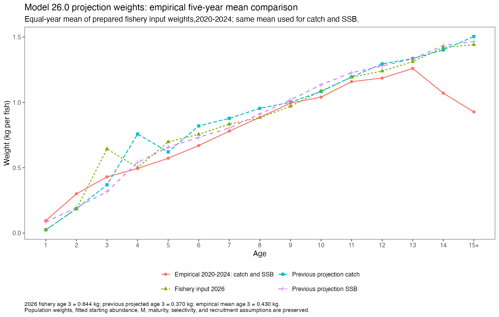
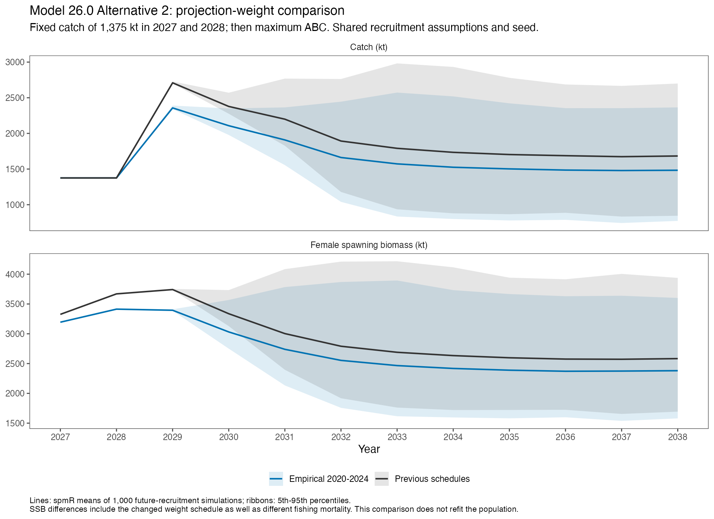

[Assessment homepage](../index.html) · [Current assessment](assessment.html)

This comparison replaces both the **projection fishery catch weights** and
**spawning-biomass weights** with the age-specific arithmetic mean of the
prepared empirical fishery weight inputs for **2020–2024**. Each year receives
equal weight. The same 15-age vector is used for catch and SSB and is held fixed
through 2027–2038. The original assessment and its projection products are
preserved; these comparison results are separate from the assessment baseline.

[Extended comparison with original and doubled-CV WtAgeRE forecasts](projection-re-weight-comparison.html)
adds the saved weight-model forecasts and a matched CV-effect control.

## Age-3 concern and the scope of this comparison

The empirical five-year age-3 mean is **0.430 kg**. The weight supplied for the
2026 fishery is about **0.644 kg**, while the original *projection* catch schedule
already uses the 2027 forecast, about **0.370 kg** at age 3. Thus the new
comparison increases projected age-3 catch weight relative to the prior
projection, even though it is below the high 2026 input. The full catch and
SSB curves also change; effects cannot be assigned to age 3 alone. The age-4
catch-weight contrast is particularly large: **0.758 kg** in the previous
forecast versus **0.494 kg** in the empirical mean.

The fitted 2026 abundance and mortality are retained when forming the initial
2027 population. This experiment therefore measures sensitivity to **future
projection weight assumptions**, rather than removing the high 2026 weight
from the assessment fit. The separate
[BTS-observation-CV sensitivity](weight-at-age-bts-cv-sensitivity.html) evaluates
its influence within the standalone weight model. Neither comparison refits
the stock assessment or replaces its advice.



## Results with matched recruitment draws

```{r}
library(readr)
library(dplyr)
library(tidyr)
library(gt)
library(jsonlite)
r <- "projection-empirical-weight-comparison"
s <- read_csv(file.path(r, "native_short_term_comparison.csv"), show_col_types = FALSE) |>
  filter(case_id == "primary")
b <- s |> filter(weight_case == "previous") |>
  select(Year, previous_ABC = ABC, previous_OFL = OFL, previous_SSB = SSB, previous_F = F)
z <- s |> filter(weight_case == "empirical_2020_2024") |>
  left_join(b, by = "Year") |>
  mutate(ABC_change_percent = 100 * (ABC / previous_ABC - 1),
         OFL_change_percent = 100 * (OFL / previous_OFL - 1))
a <- read_json(file.path(r, "paired-input-audit.json"), simplifyVector = TRUE)
v <- read_json(file.path(r, "native_verification.json"), simplifyVector = TRUE)
i <- read_json(file.path(r, "independent-verification.json"), simplifyVector = TRUE)
stopifnot(a$status == "PASS", v$status == "PASS",
          i$rows_independently_replayed == 168,
          i$maximum_relative_state_catch_policy_error < 1e-9)
```

Under the primary selectivity assumption, maximum ABC decreases by
**`r abs(round(z$ABC_change_percent[z$Year == 2027], 1))`% in 2027** and
**`r abs(round(z$ABC_change_percent[z$Year == 2028], 1))`% in 2028**. The expected catch
remains 1,375 kt in both years. Higher fishing mortality is required to take
that fixed tonnage under the empirical catch-weight schedule.

```{r}
z |>
  select(Year, previous_ABC, ABC, ABC_change_percent, previous_OFL, OFL) |>
  gt() |>
  fmt_number(columns = -Year, decimals = 1, use_seps = TRUE) |>
  cols_label(previous_ABC = "Previous max ABC (kt)", ABC = "Empirical max ABC (kt)",
             ABC_change_percent = "ABC change (%)", previous_OFL = "Previous OFL (kt)",
             OFL = "Empirical OFL (kt)") |>
  tab_source_note("Native spmR means across 1,000 future-recruitment simulations; Alternative 2. These are comparison outputs, not adopted catch advice.")
```

The SSB differences reflect the altered weight schedule as well as changes in
fishing mortality and surviving age structure. They represent a changed
projection calculation, rather than evidence for a change in the fitted
population. SPR reference fishing rates and biomass reference points are
recalculated consistently with the new SSB weights.

```{r}
refs <- read_csv(file.path(r, "reference_point_comparison.csv"), show_col_types = FALSE) |>
  filter(case_id == "primary") |>
  select(weight_case, B35_kt, B40_kt, F40, F35)
refs |>
  gt() |>
  fmt_number(columns = c(B35_kt, B40_kt), decimals = 1, use_seps = TRUE) |>
  fmt_number(columns = c(F40, F35), decimals = 4) |>
  cols_label(weight_case = "Schedules", B35_kt = "B35% (kt)", B40_kt = "B40% (kt)")
```



## Inputs and averaging

The source is the prepared annual **observation input**, before WtAgeRE
smoothing or prediction. Historical 2020–2023 inputs retain their existing
age basis and previously authorized interpolation for sparse cells. The 2024
inputs use the year-specific FT-NIR-to-independent-TMA conversion, including
the approved tail preparation. Hence “empirical” here distinguishes the
prepared annual data curves from fitted/predicted weight curves; it does not
imply that every sparse historical cell had an independent observation.
All five age-3 annual values are available without the historical mean fills.

```{r}
w <- read_csv(file.path(r, "empirical_weight_schedule.csv"), show_col_types = FALSE)
w |>
  gt() |>
  fmt_number(columns = weight_kg, decimals = 4) |>
  cols_label(age_bin = "Age (15 = 15+)", weight_kg = "Catch and SSB weight (kg)",
             years = "Annual input values")
```

[All 75 annual inputs](projection-empirical-weight-comparison/empirical_annual_fishery_weights.csv) ·
[Inherited historical gap-filling record](projection-empirical-weight-comparison/inherited_gap_filling.csv)

The population-biomass weights stay at their previous 2026 values. Maturity,
natural mortality, sex ratio, spawning timing, fitted initial population,
recruitment history, fixed catches, and selectivity are held constant.
The primary selectivity average is 2023–2025; the 2024–2026 window check is
also repeated. Both cases use the 1978–2023 age-1 recruitment history, the same
random seed (123), and **identical recruitment draws for each simulation,
year, and scenario**. All seven harvest scenarios are run through 2038.

## Verification and downloads

The matched runs use the same frozen spmR **0.4.1** package and ADMB projection
runtime. All 12 native executions exit 0 and pass fresh-output checks.
The only numerical species-input vectors that differ between matched cases
are catch and spawning weights; population-weight metadata are identical.
These historical-recruitment projections estimate no parameters, so optimizer
gradients and Hessian checks are inapplicable. The fitted assessment is read
without refitting.

An independent Python replay checks all **168 deterministic scenario-year
rows** across both selectivity windows, including SPR roots, catch solutions,
the B20 closure, and plus-group accounting. Its maximum relative error is
below 5 × 10⁻¹³. Native first-year projections also agree with the independent
calculation within output precision. Projection intervals represent future
recruitment variation, conditional on fixed inputs; assessment and weight
uncertainty are outside these intervals.

- [Short-term native results](projection-empirical-weight-comparison/native_short_term_comparison.csv)
- [Native annual summaries](projection-empirical-weight-comparison/native_annual_summaries.csv)
- [Reference points](projection-empirical-weight-comparison/reference_point_comparison.csv)
- [Deterministic scenarios](projection-empirical-weight-comparison/deterministic_all_model_scenarios.csv)
- [Paired-input audit](projection-empirical-weight-comparison/paired-input-audit.json)
- [Native execution verification](projection-empirical-weight-comparison/native_verification.json)
- [Independent replay](projection-empirical-weight-comparison/independent-verification.json)
- [Comparison scope and source notes](projection-empirical-weight-comparison/comparison_scope.json)
- [Weight-curve PDF](tables/projection-empirical-weight-curves.pdf)
- [Trajectory PDF](tables/projection-empirical-weight-trajectories.pdf)

Manual accessibility review remains pending.
