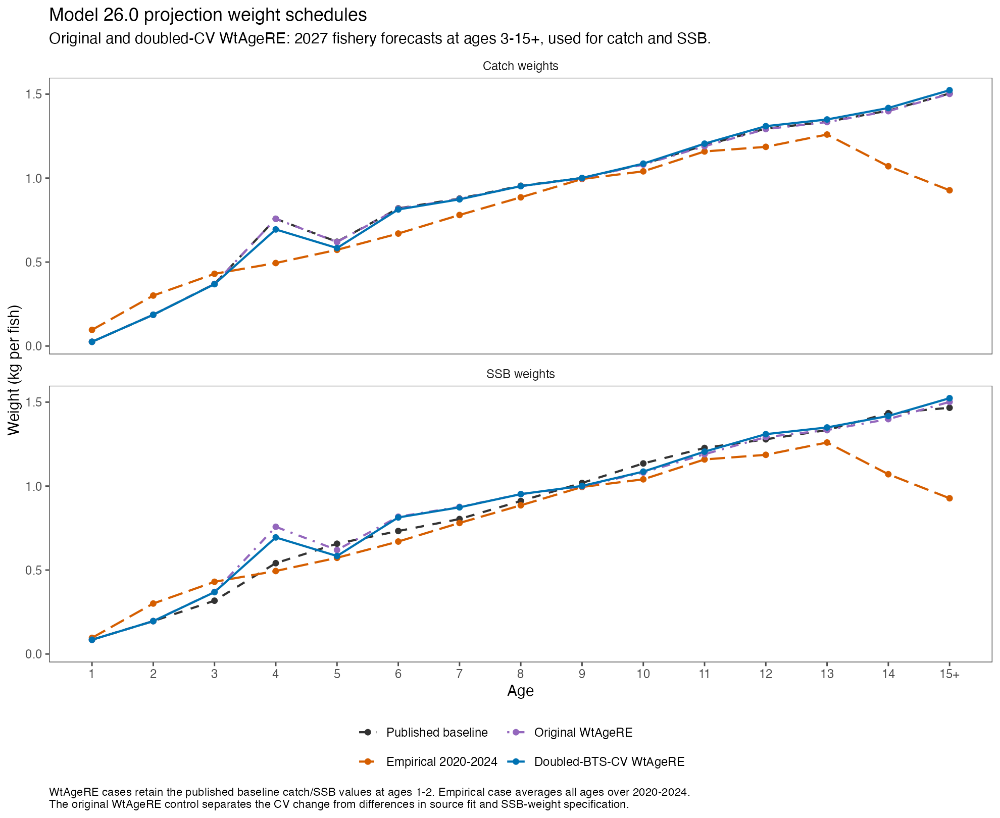
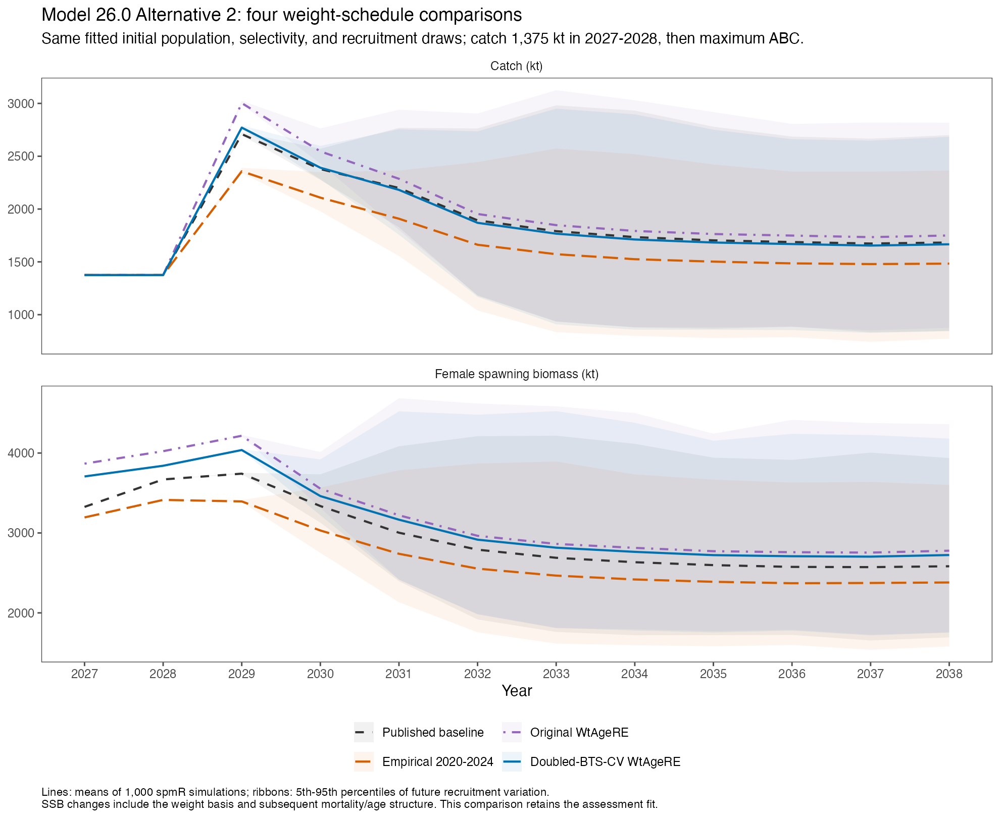

[Homepage](../index.html) · [Current assessment](assessment.html) ·
[Earlier empirical-mean comparison](projection-empirical-weight-comparison.html)

These are **comparison runs**, retaining the published assessment and its
projections. The new case uses fishery weights from the saved WtAgeRE run in
which BTS observation CVs were doubled for 2025–2026. No weight-model or stock-
assessment refit is performed here. All projections use the same fitted
starting population, mortality, maturity, selectivity, recruitment history,
and matched future recruitment draws.

## What is compared

1. **Published baseline:** the prior projection catch-weight forecast and
   carried 2026 spawning weights.
2. **Empirical 2020–2024:** the equal-year arithmetic mean of the prepared
   annual fishery inputs, used for both catch and SSB at all ages.
3. **Original WtAgeRE control:** 2027 fishery forecasts from the original saved
   WtAgeRE fit, used for both catch and SSB at ages 3–15+.
4. **Doubled-BTS-CV WtAgeRE:** 2027 fishery forecasts from the doubled-CV fit,
   used under exactly the same rules as the original-WtAgeRE control.

WtAgeRE estimates ages 3–15+. Both WtAgeRE projection cases retain their
respective published-baseline catch and spawning weights for ages 1–2.
The selected **2027 forecast vector is fixed throughout 2027–2038**;
it is not replaced by the separate 2028 forecast in later years. Population-
biomass weights are unchanged. The fishery forecast is explicitly used as
an SSB-weight proxy in both WtAgeRE cases, matching the common-curve idea in
the empirical comparison at modeled ages.

The original-WtAgeRE control is essential for interpreting the CV change:
the published baseline has a different source fit and SSB specification.
**The original-versus-doubled WtAgeRE contrast isolates the CV sensitivity**;
comparisons with the published baseline or empirical means combine additional
weight-schedule differences.



## Short-term results

```{r}
library(readr)
library(dplyr)
library(tidyr)
library(gt)
library(jsonlite)
r <- "projection-re-weight-comparison"
labels <- c(previous = "Published baseline", empirical_2020_2024 = "Empirical 2020–2024",
            original_re = "Original WtAgeRE", double_cv = "Doubled-BTS-CV WtAgeRE")
s <- read_csv(file.path(r, "native_short_term_comparison.csv"), show_col_types = FALSE) |>
  filter(case_id == "primary")
audit <- read_json(file.path(r, "four_case_audit.json"), simplifyVector = TRUE)
stopifnot(audit$status == "PASS", nrow(s) == 8)
abc <- s |> select(weight_case, Year, ABC) |>
  pivot_wider(names_from = Year, values_from = ABC)
abc |>
  mutate(Case = factor(labels[weight_case], levels = labels)) |>
  arrange(Case) |>
  select(Case, `2027`, `2028`) |>
  gt() |>
  fmt_number(columns = c(`2027`, `2028`), decimals = 1, use_seps = TRUE) |>
  cols_label(`2027` = "2027 max ABC (kt)", `2028` = "2028 max ABC (kt)") |>
  tab_source_note("Native spmR means over 1,000 simulations, Alternative 2; expected catch remains 1,375 kt in 2027 and 2028.")
```

The doubled-CV case gives maximum ABC of about **2,297 kt in 2027** and
**2,376 kt in 2028**. Relative to the published projection baseline, these
are increases of **3.3% and 2.5%**. Relative to the empirical-mean case,
they are increases of **11.7% and 10.5%**.

Under the matched WtAgeRE specification, doubling the recent BTS CVs reduces
maximum ABC by **7.0% in 2027** and **7.8% in 2028**. This last contrast is
the direct CV-effect comparison. The CV change affects the full fitted and
forecast age profile, so the projection effect represents more than a
change to projected age-3 weight alone.

```{r}
s |>
  mutate(Case = factor(labels[weight_case], levels = labels)) |>
  arrange(Case, Year) |>
  select(Case, Year, SSB, OFL, F) |>
  gt() |>
  fmt_number(columns = c(SSB, OFL), decimals = 1, use_seps = TRUE) |>
  fmt_number(columns = F, decimals = 4) |>
  cols_label(SSB = "Female SSB (kt)", OFL = "OFL (kt)", F = "F for prescribed catch")
```

SSB values use different weight schedules and therefore reflect both the
weight basis and subsequent fishing mortality/age structure. These are
conditional projections of the same fitted starting population, not new
assessment estimates of the stock.

## Age-3 context and full weight curves

The 2026 WtAgeRE weight peak was the motivation for these comparisons. The
standard projection convention uses the **2027 forecast**, rather than
carrying the large 2026 age-3 value forward at age 3. Effects also appear at
older forecast ages, making the full age profile relevant.

```{r}
w <- read_csv(file.path(r, "age_schedules.csv"), show_col_types = FALSE) |>
  filter(case_id == "primary", age %in% 3:7) |>
  select(weight_case, age, fishery_weight) |>
  mutate(weight_case = unname(labels[weight_case])) |>
  pivot_wider(names_from = weight_case, values_from = fishery_weight)
w |> gt() |> fmt_number(columns = -age, decimals = 3) |>
  cols_label(age = "Age") |>
  tab_source_note("Projected catch weight in kg. The empirical inputs retain their documented historical sparse-cell preparation.")
```

## Projection trajectories and reference points



```{r}
read_csv(file.path(r, "reference_point_comparison.csv"), show_col_types = FALSE) |>
  filter(case_id == "primary") |>
  mutate(Case = factor(labels[weight_case], levels = labels)) |>
  arrange(Case) |>
  select(Case, B35_kt, B40_kt, F40, F35) |>
  gt() |>
  fmt_number(columns = c(B35_kt, B40_kt), decimals = 1, use_seps = TRUE) |>
  fmt_number(columns = c(F40, F35), decimals = 4) |>
  cols_label(B35_kt = "B35% (kt)", B40_kt = "B40% (kt)")
```

Reference points are recalculated for each SSB-weight schedule. All seven
harvest scenarios are compared through 2038, with both the 2023–2025 primary
selectivity average and the 2024–2026 window check. The 1,375-kt catches apply
only to Alternative 2 in 2027–2028. Intervals represent future recruitment
variation; assessment and weight-estimation uncertainty are outside them.

## Verification and downloads

The new runs use the same frozen spmR 0.4.1 package and ADMB runtime as the
previous comparison, with 1,000 simulations and seed 123. For every matched
case, the only numerical species-input vectors changed are catch and
spawning weights. Population-weight metadata are identical. Recruitment
draws match exactly by scenario, simulation, and year across all four cases.
All new native executions exited 0 and passed fresh-output checks.

An independent replay verifies all 168 deterministic scenario-year rows for
each of the two new cases (336 rows total), including SPR roots, the fixed-
catch solutions, the B20 rule, and the plus group. Maximum relative errors
are below 9 × 10⁻¹⁴. Fresh first-year native results agree with the
independent calculations within output precision. These historical-recruitment
projections estimate no parameters, so optimizer gradients and Hessians are
inapplicable here; the saved weight-model fits retain their separate
convergence records.

- [Short-term results](projection-re-weight-comparison/native_short_term_comparison.csv)
- [Annual summaries for all scenarios](projection-re-weight-comparison/native_annual_summaries.csv)
- [Age schedules](projection-re-weight-comparison/age_schedules.csv)
- [Reference points](projection-re-weight-comparison/reference_point_comparison.csv)
- [Four-case input and draw audit](projection-re-weight-comparison/four_case_audit.json)
- [New native-run verification](projection-re-weight-comparison/native_verification_new_cases.json)
- [Original-RE independent replay](projection-re-weight-comparison/original_re_independent_verification.json)
- [Doubled-CV independent replay](projection-re-weight-comparison/double_cv_independent_verification.json)
- [Weight-curve PDF](tables/projection-re-comparison-weights.pdf)
- [Trajectory PDF](tables/projection-re-comparison-trajectories.pdf)
- [Standalone doubled-CV weight fit](weight-at-age-bts-cv-sensitivity.html)

The original assessment and advice remain unchanged. Manual accessibility
review is pending.
