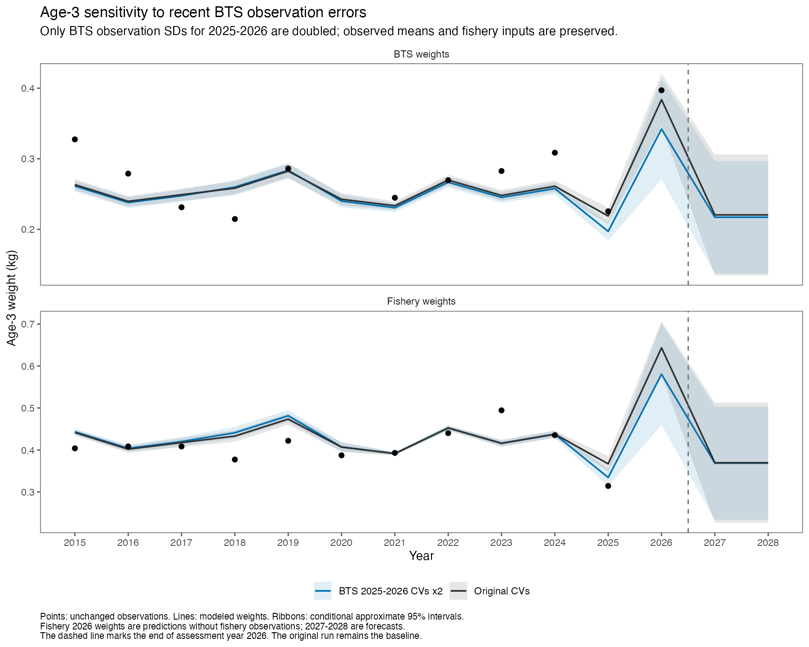
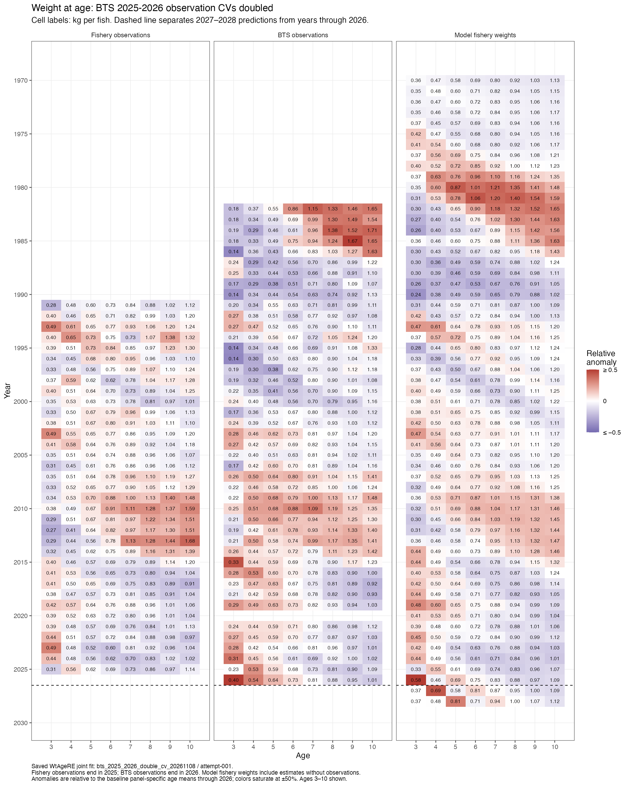

[Assessment homepage](../index.html) · [Current assessment](assessment.html)

This separate sensitivity doubles the observation SDs for BTS weight at age in
2025 and 2026. Observed means are identical, so CVs double and variances increase
fourfold. All other input values, the saved RTMB model and adapter, default
starts, and fitting procedure are preserved. The original fit and assessment
outputs remain the baseline; this sensitivity has no assessment-model refit.

## Fit and input checks

```{r}
library(readr)
library(dplyr)
library(gt)
library(jsonlite)
r <- "weight-at-age-bts-cv-sensitivity"
d <- read_json(file.path(r, "diagnostics.json"), simplifyVector = TRUE)
a <- read_json(file.path(r, "independent_audit.json"), simplifyVector = TRUE)
ch <- read_csv(file.path(r, "input_changes.csv"), show_col_types = FALSE)
x <- read_csv(file.path(r, "age3_comparison.csv"), show_col_types = FALSE)
stopifnot(d$passed, d$max_gradient < 1e-4, d$hessian_positive_definite,
          d$warning_count == 0, a$status == "PASS", a$means_identical,
          a$fishery_SDs_identical, a$BTS_other_year_SDs_identical,
          a$recent_BTS_SDs_doubled, a$baseline_files_preserved)
```

The fit converged with a maximum gradient of
**`r format(d$max_gradient, scientific = TRUE, digits = 3)`** and a positive-definite
fixed-parameter Hessian (minimum eigenvalue **`r round(d$min_hessian_eigenvalue, 3)`**).
The conditional random-effect Hessian and joint uncertainty precision are also
positive definite. Model graph construction and fitting captured zero warnings;
the fitting process exited 0. An independent graph rebuild reproduced the
objective and verified gradients and curvature.

The input file contains **`r nrow(ch)` changed SD cells** (all ages 1–15 for both
recent BTS years). Of these, **`r a$affected_fitted_BTS_cells` observations at ages
3–15** enter this fit. Means, observation masks, fishery inputs, and BTS errors
in every other year were independently checked against the original run.
The converted TMA age basis and fixed conversion-key treatment are preserved.

## Effect on age 3

The 2026 modeled BTS age-3 weight decreases from **0.384 to 0.342 kg**
(**−10.9%**), and the predicted fishery age-3 weight decreases from **0.643 to
0.580 kg** (**−9.8%**). The observed values remain unchanged. Both series respond
because the standalone model fits fishery and BTS data jointly; the fishery
2026 value is a prediction rather than an observation.

```{r}
x |>
  filter(year %in% 2024:2028) |>
  select(dataset, year, baseline_kg, sensitivity_kg, change_percent) |>
  gt() |>
  fmt_number(columns = c(baseline_kg, sensitivity_kg), decimals = 3) |>
  fmt_number(columns = change_percent, decimals = 1) |>
  cols_label(dataset = "Series", year = "Year", baseline_kg = "Original (kg)",
             sensitivity_kg = "Doubled BTS CV (kg)", change_percent = "Change (%)")
```



## Remade heatmap

The Fishery and BTS observation panels are unchanged. The third panel shows
the new modeled fishery weights through 2028. Colors use the original plot's
panel- and age-specific reference means through 2026, so the anomaly reference
and color limits are held fixed between the two figures. Cell labels are kg per
fish, not anomalies.



[Heatmap PDF](tables/waa-heatmap-bts-double-cv-through-2028.pdf) ·
[Age-3 comparison PDF](tables/waa-age3-bts-double-cv-comparison.pdf) ·
[Original heatmap](assets/waa-heatmap-through-2028.png)

## Saved results and scope

- [All modeled-weight comparisons](weight-at-age-bts-cv-sensitivity/model_comparison.csv)
- [Age-3 comparison](weight-at-age-bts-cv-sensitivity/age3_comparison.csv)
- [Exact changed SDs and CVs](weight-at-age-bts-cv-sensitivity/input_changes.csv)
- [Numerical diagnostics](weight-at-age-bts-cv-sensitivity/diagnostics.json)
- [Independent audit](weight-at-age-bts-cv-sensitivity/independent_audit.json)
- [Run provenance](weight-at-age-bts-cv-sensitivity/provenance.json)

Run: `bts_2025_2026_double_cv_20261108/attempt-001`; baseline:
`ebs_fishery2026_pool9_12_cv100_20261022/attempt-001`. Numerical convergence
establishes an estimable sensitivity, while scientific adoption remains a
separate assessment decision. Likelihood objectives use different assumed
observation errors and therefore provide no direct test of improved fit.
No assessment biomass, harvest advice, or assessment weights were replaced.
Manual accessibility review is pending.
